# THREAD

A local-first, Core/Host workspace for worldbuilders and writers. It takes Notion's relational blocks, Obsidian's plain-file resilience, Word-grade publishing and Scrivener's manuscript binding, and puts them in one modular, tactile interface.

`docs/DESIGN.md` is the design document this build follows. The reference boards it cites are in `docs/references/`.

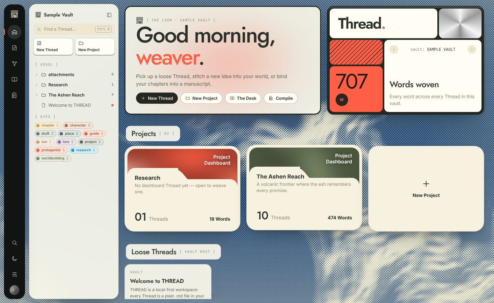

## Vocabulary

| UI term | What it literally is |
| --- | --- |
| **Thread** | A plain `.md` file. |
| **Stitch** | A bidirectional `[[Link]]` (`[[Target#anchor\|alias]]`). |
| **Deep Stitch** | A Stitch into a PDF coordinate: `[[Research.pdf#page=12&highlight=h4f2]]`. |
| **Dye** | A tag in YAML frontmatter (`dyes: [lore]`; Obsidian's `tags:` also works), drawn as a colored badge. |
| **Table** | A typed, relational block. It is saved as a portable GFM table plus a one-line schema comment. |
| **Project** | A folder. Clicking it opens its dashboard Thread (`Project/Project.md`). |
| **Tapestry** | The graph view, with two modes: **Web** (force-directed) and **Loom** (git-graph-style lanes). |
| **Pinboard** | An infinite Excalidraw canvas, saved as a fenced `thread-pinboard` JSON block inside a Thread. |
| **The Desk** | PDF reader on the left, the active Thread on the right. |
| **The Compiler** | Binds Threads into a print-ready PDF or DOCX, or uses Pandoc on desktop. |

## What's in the box

- **Canvas**: a TipTap 3 editor that renders Markdown visually and serializes straight back to the literal `.md` file. The round trip is covered by tests.
  - Type `/` to open the modular block menu: headings, lists, to-dos, quote, code, divider, Table, simple grid, Pinboard, image, Stitch, Deep Stitch.
  - Type `[[` to get a fuzzy Stitch picker. Picking a name that doesn't exist yet creates that Thread when the Stitch is first clicked.
  - Select text to get a bubble menu with formatting, highlight, link and "Stitch the selection".
  - Paste or drop images and PDFs straight into the vault.
- **Spool** (left): a floating rail and a nested Project tree. Rows have punchy hover states, a right-click menu (new, rename, delete), drag-to-move and OS file drops. Below the tree is a Dye list that filters the Spool.
- **Stitching** (right): backlinks with the surrounding line, outgoing Stitches, an outline, Dye editing with palette swatches, and tactile frontmatter controls. Properties use rocker toggles, rotary knobs for numbers, dates, lists and Stitch properties.
- **Tables**: typed columns (Text, Number with Σ totals, Stitch, Dye, Check, Date), sorting and add/remove. Stitch cells are real links, so relations show up in the Tapestry and in backlinks.
- **The Desk**: a pdf.js reader with a text layer.
  1. Select a passage.
  2. Pick a Dye.
  3. THREAD records a coordinate-level highlight (`.thread/highlights/…json`), then inserts the quote and a Deep Stitch into the active Thread.

  Clicking that Deep Stitch later reopens the PDF scrolled to the highlight, which flashes.
- **Compiler**: drag-and-drop manuscript cards with roles (Title, Front, Chapter, Appendix), a paginated preview, page size, serif or sans, running header, page numbers and chapter breaks. It strips UI-only syntax (Dyes, Stitch brackets, Pinboards, table schemas) before typesetting. Exports go to PDF (pdfmake), DOCX (docx) or clean Markdown. On desktop, Pandoc can also produce PDF, DOCX or EPUB.
- **Personalization** ("Make your THREAD your own"):
  - Backdrops: generated halftone clouds, pixel-mosaic clouds, aurora radial blur, paper, or your own image.
  - Sky tint, radial-blur intensity, card opacity and film grain.
  - Writing and display fonts (Inter, Jost, Literata, JetBrains Mono).
  - Accent color, light/dark/auto theme, and three Dye palettes taken from the reference boards (Earth, Signal, Loom).
  - Window corners: **Radial** (rounded, the default), **Diagonal** (chamfered) or **Square** (sharp modern cuts), applied to every panel, card, button and chip. Diagonal uses native CSS `corner-shape: bevel` where the browser supports it (Chrome, Edge, the Windows app) and a clip-path fallback elsewhere (Safari, iPad, Linux/macOS app).
- **Deadlines and reminders**:
  - Set a date (and optionally a time) in the Stitching panel's Deadline module. It is stored as `deadline:` / `remind:` in the frontmatter.
  - Or write a dated to-do anywhere: `- [ ] Draft chapter 📅 2026-11-01 ⏰ 14:30`. This is the Obsidian Tasks syntax; type `/due` to insert one.
  - **Coming up** on the Loom lists overdue and upcoming items.
  - While THREAD is open you get system notifications: the browser Notification API or a service worker, and the native notification plugin on desktop.
- **Google Calendar**:
  - Deadlines sync into a calendar THREAD creates for itself, using the narrow `calendar.app.created` scope. THREAD cannot see or change your other calendars.
  - Sync is idempotent: new deadlines are created, changed ones updated, removed ones deleted.
  - Google then delivers the reminders to your phone even when THREAD is closed, and each event links back to its Thread (`#open=<path>`).
  - No-OAuth alternatives: **Export .ics**, or subscribe Google Calendar to the Loom's `/calendar.ics` feed.
- **Activity heat map**: a GitHub-style grid of the days you wrote.
  - Each day is painted in the Dye colors of the Threads you worked on. Several Dyes split the cell into up to three bands, and intensity follows the amount of writing.
  - Tap a day to list its Threads, filter by Dye, and see your current and longest streaks.
  - Each Thread's Stitching panel has its own strip ("Woven on").
  - Each device logs to `.thread/activity/<device>.json`, so the Loom merges history across devices without devices overwriting each other.
- **Responsive and installable**:
  - Phone portrait and iPad portrait get a bottom navigation bar.
  - Phones in landscape get a slim side rail.
  - The Spool and Stitching panels become overlays you dismiss with a tap outside.
  - Touch-only controls: "⋯" row menus, up/down manuscript buttons, and long-press text selection at the Desk.
  - In the browser THREAD is an installable PWA (manifest + service worker) that opens and edits offline.
- **Keyboard**:

  | Shortcut | Action |
  | --- | --- |
  | `Ctrl/⌘ K` | Open the switcher and commands |
  | `Ctrl/⌘ \` | Show or hide the Spool |
  | `Ctrl/⌘ ⇧ \` | Show or hide the Stitching panel |
  | `Ctrl/⌘ ,` | Personalize |
  | `Alt 1–5` | Switch views |
  | `Ctrl/⌘ Alt N` | New Thread |

| | |
| --- | --- |
| 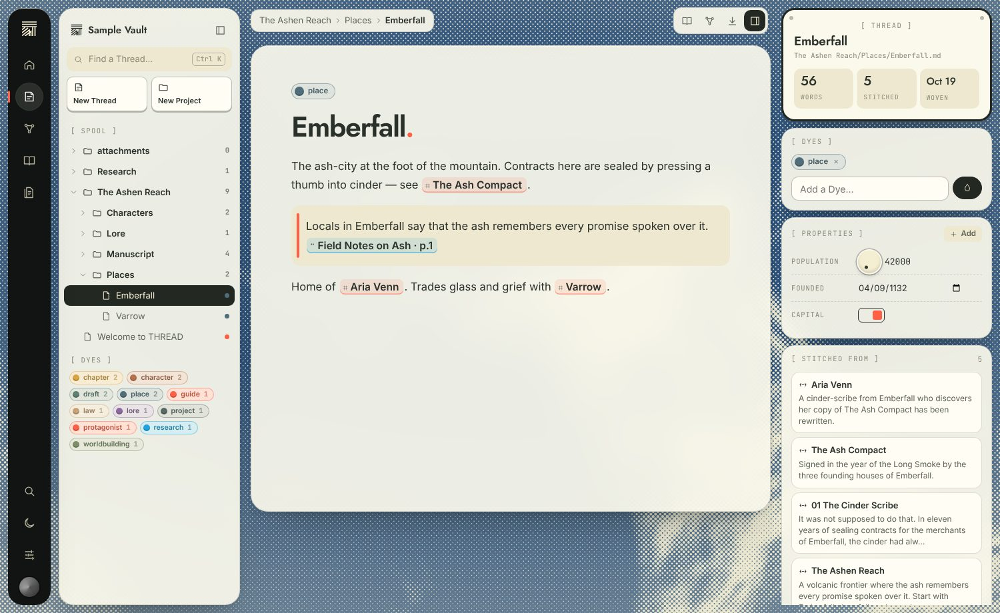 | 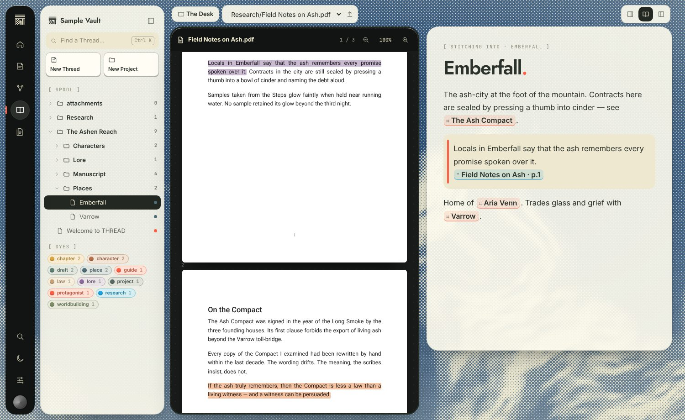 |
| 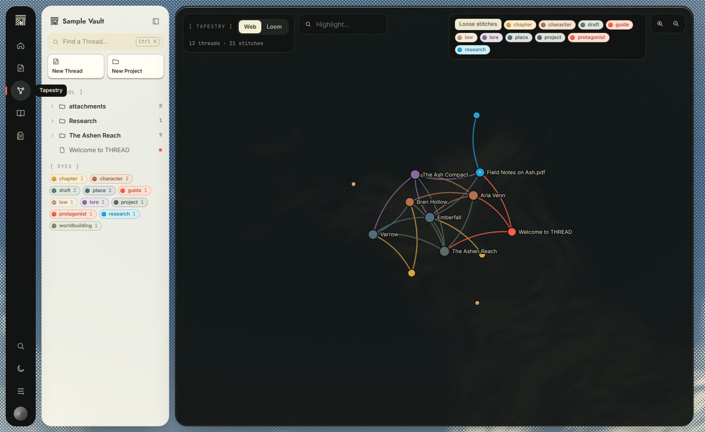 | 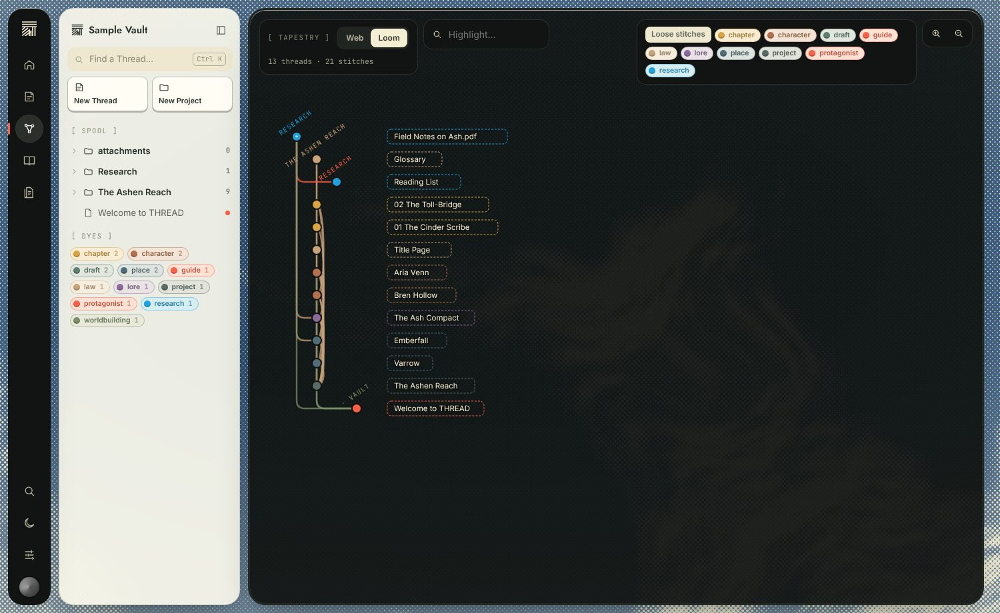 |
| 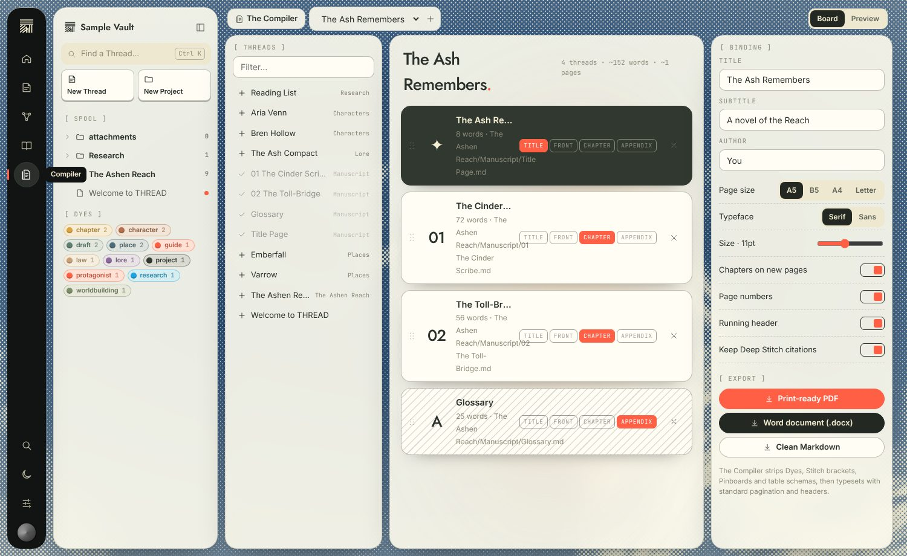 | 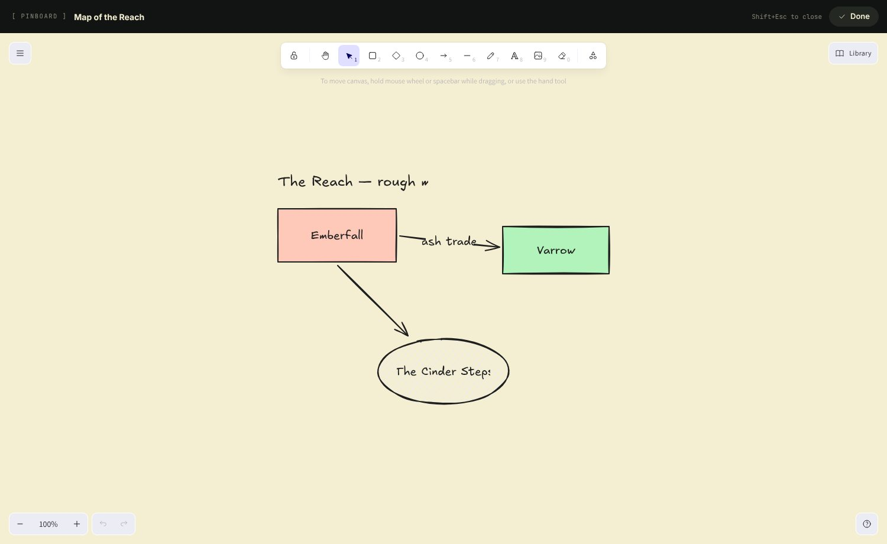 |
| 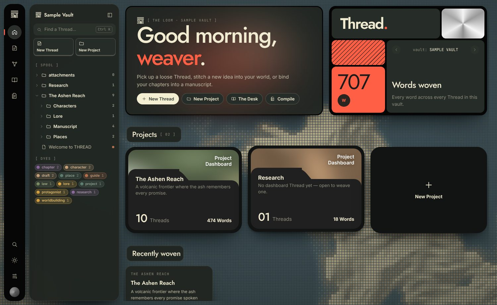 | 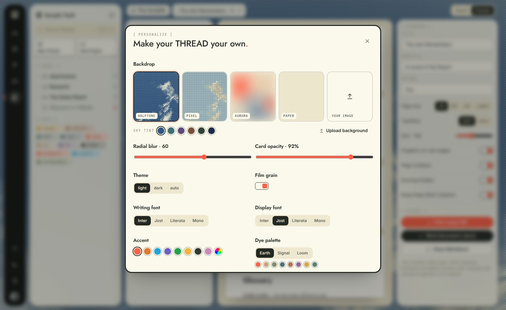 |
| 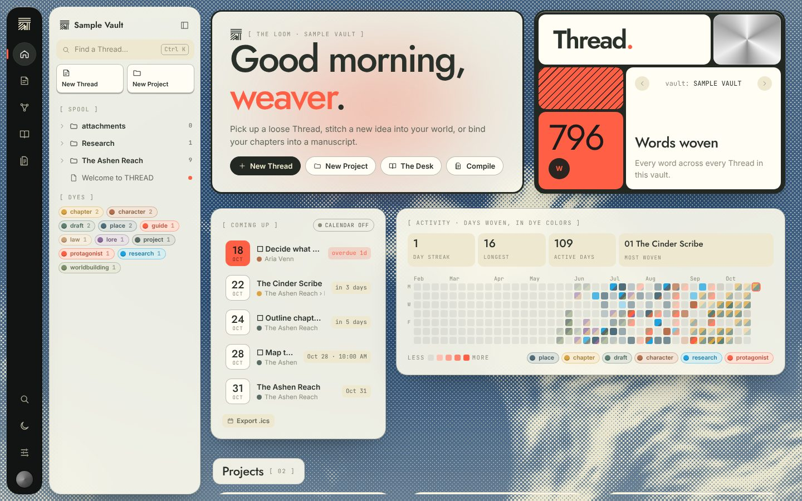 | 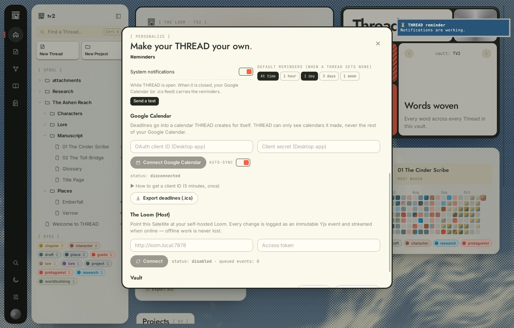 |

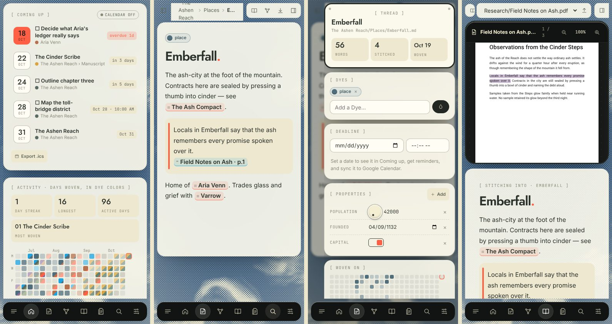
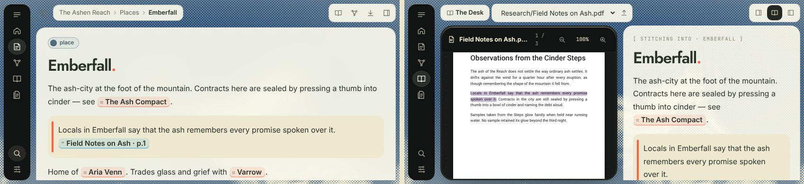

## Architecture

```
┌──────────────────────── Satellites ────────────────────────┐        ┌──────── The Loom (Host) ────────┐
│ Desktop (Tauri)   Browser / iPad PWA   …                    │        │ loom/server.mjs (Node, Docker)  │
│                                                             │  WS    │                                 │
│  Vault adapter ── plain .md / PDFs / images                 │ ─────▶ │  Yjs merge per Thread           │
│  Y.Doc per Thread (Y.Text "md")                             │ events │  writes merged .md to disk      │
│  Outbox (IndexedDB): every change = immutable Yjs update    │ ◀───── │  .loom/events.log (audit)       │
│  streams when online, survives offline                      │  fan-out│  watches disk for outside edits │
└─────────────────────────────────────────────────────────────┘  HTTP  │  /assets (PDFs, images, .thread)│
                                                                       └─────────────────────────────────┘
```

- **Storage adapters** (`src/core/vault.ts`), all speaking literal files and vault-relative paths:
  - **Tauri**: native folder access through Rust commands, confined to the vault root, with binary data sent as raw IPC.
  - **Folder**: the File System Access API, for a real folder from Chromium.
  - **Browser**: IndexedDB, used by PWAs and as an offline cache.
- **Sync** (`src/core/sync.ts`, `shared/ytext.js`):
  - Each Thread is a `Y.Doc` whose `Y.Text` is the Markdown file. Edits become minimal splices, so concurrent changes from different devices merge character by character.
  - A file's first baseline uses a client id derived from its path and content. Two devices that start tracking the same file therefore de-duplicate instead of doubling it.
  - Keystrokes not yet saved are folded into the CRDT before a remote update is applied.
- **The Loom**:
  - Merges every incoming event and writes plain Markdown.
  - Appends each event to `.loom/events.log`.
  - Folds edits made directly on the server's disk into the CRDT, so you can still use Obsidian or git on the Host.
  - Syncs PDFs, images and `.thread/` metadata (Dye colors, highlights, manuscripts) last-writer-wins over HTTP.

### Files on disk

```
My Vault/
├── Welcome.md
├── The Ashen Reach/
│   ├── The Ashen Reach.md        ← Project dashboard (folder note)
│   └── Places/Emberfall.md
├── Research/Field Notes.pdf
├── attachments/map.png
└── .thread/                      ← app metadata (like .obsidian/)
    ├── dyes.json
    ├── manuscripts.json
    └── highlights/Research/Field Notes.pdf.json
```

## Running it

Requires Node 20+.

```bash
npm install
npm run dev            # http://localhost:1420 — pick "Explore the sample world"
npm test               # editor round-trip, core, exports, and a live Loom with two Satellites
npm run build          # production web build in dist/
```

### Phones and tablets

Serve the production build (`npm run build`, then any static host or `npx vite preview --host`) and open it on the device. Use **Add to Home Screen** to install it. On iPhone this step is required for notifications.

The vault lives in the browser's IndexedDB on that device. Connect a Loom to share it with your other devices.

### Desktop (Tauri 2)

```bash
# Linux prerequisites: libwebkit2gtk-4.1-dev libgtk-3-dev librsvg2-dev (see tauri.app)
npm run tauri dev
npm run tauri build
```

Desktop adds:

- native folder vaults; you can also open one from the command line with `thread ~/Worlds` or `THREAD_VAULT=~/Worlds`
- a native save dialog for exports
- native notifications
- Pandoc typesetting, if `pandoc` is on `PATH`

### Google Calendar setup (once)

1. In console.cloud.google.com, create a project and enable the **Google Calendar API**.
2. On the OAuth consent screen, choose External and add yourself as a test user.
3. Create an OAuth client:
   - **Browser / PWA**: type *Web application*, with the origin you serve THREAD from (for example `https://thread.example.com`) as an authorized JavaScript origin.
   - **Desktop app**: type *Desktop app*. Sign-in opens in your system browser and returns through a loopback redirect, using PKCE.
4. In THREAD, open **Make it yours → Google Calendar**, paste the client ID (plus the client secret for Desktop) and press **Connect**.

If you'd rather not create an OAuth client, run a Loom and subscribe from Google Calendar to `https://<loom>/calendar.ics?token=…` (*Other calendars → From URL*). Set `LOOM_APP_URL` so events link back to THREAD.

### The Loom (Host)

```bash
LOOM_TOKEN=change-me docker compose up -d          # master vault in ./loom-data/vault
# or without Docker:
LOOM_DIR=~/vault LOOM_TOKEN=change-me npm run loom
```

Next, connect each Satellite. Either go to **Make it yours → The Loom** and enter `http://<host>:7878` with the token, or choose **Connect to a Loom** on the welcome screen.

Put the Loom behind TLS (for example Caddy or Tailscale) if it is reachable from outside your network. The token is the only access control.

## Project layout

```
src/core/       vault adapters, store, markdown/frontmatter, tables, sync, compiler, backdrops, seed
src/editor/     TipTap extensions: Stitch, Table, Pinboard, image, slash menu, Stitch picker
src/components/ Rail, Spool, Stitching, palette, settings, backdrop, logo, icons
src/views/      Home (the Loom), Canvas, Tapestry, Desk (+ PdfReader), Compiler
src/styles/     design tokens + the component styles
shared/         CRDT helpers shared by the app and the Loom
loom/           the Host server + Dockerfile
src-tauri/      Rust desktop host
tests/          vitest suites
```

## Testing

`npm test` runs 35 tests. They cover:

- the editor's Markdown round trip
- parsing and tables
- PDF/DOCX export
- deadline extraction, reminder timing and ICS output
- Google Calendar sync against an in-memory fake of the Calendar API
- activity merging and streaks
- a live Loom with two Satellites: offline merges, external disk edits, assets and the calendar feed

`cd src-tauri && cargo test` covers vault path confinement, the PKCE challenge (RFC 7636 vector) and loopback redirect parsing.

Manual run-through for this release:

| Target | How it was tested | Result |
| --- | --- | --- |
| Desktop browser | Chromium 1440×900 and 1280×720 | All views pass |
| iPad | 820×1180 portrait and 1180×820 landscape, touch emulation | All views pass |
| Phone | 390×844 portrait and 844×390 landscape, touch emulation | All views pass, no horizontal overflow |
| Desktop app | Real Tauri window (WebKitGTK) under Xvfb with a folder vault | Editing to disk, the Desk, native save dialog PDF export, Pandoc EPUB, a native notification, and the Google OAuth loopback up to Google's token endpoint |
| Installed PWA | Phone profile, offline reload | App, vault, PDF and edits all work offline |

## Status and next steps

All items listed above work and were tested as described in the Testing section.

Not built yet:

- **ePub at the Desk.** The design document allows "PDF/ePub", but only PDF is implemented. A `.epub` file is recognized and can be stitched to, but it does not open in the reader yet.
- **Rename/delete conflicts across Satellites.** These use last-writer-wins. Edits to the text inside a Thread are fully merged.
- **Signed releases and mobile store builds.** The Tauri project is ready for `tauri android/ios init`, but no signed builds have been made. On phones THREAD runs as the PWA.
- **Reminders while THREAD is closed** come from Google Calendar or the ICS feed. THREAD has no push server of its own.
- **Google Calendar sync is one-way**, from THREAD to Google. Moving an event in Google does not change the Thread.
